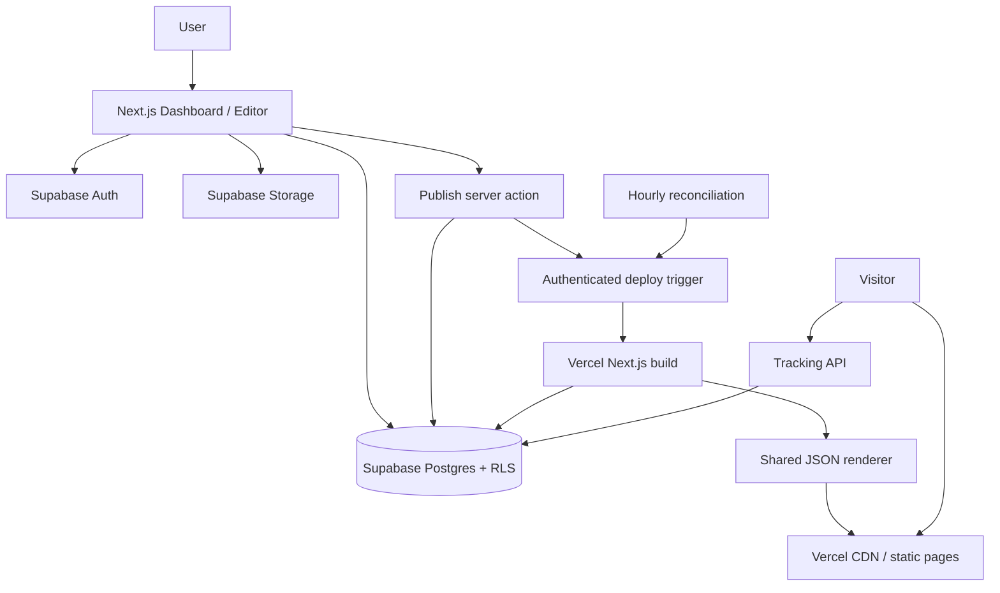

# LinkBio — Architecture

## 1. Purpose

Multi-tenant link-in-bio SaaS. A user selects a system template, creates a page instance, edits content/design tokens, previews, saves a draft and publishes to a unique URL: `/{username}/{pageSlug}`.

## 2. MVP decisions

- Next.js App Router, TypeScript, Tailwind CSS v4, shadcn/ui.
- Supabase Auth, Postgres, Storage, Row Level Security (RLS).
- Zod-validated JSON schema and shared component renderer for editor preview and public pages.
- Vercel for dashboard runtime, static prerendering and CDN.
- `generateStaticParams()` enumerates published routes during deployment; `dynamicParams = false` for public routes.
- Publish creates a durable published snapshot and requests a deployment; **do not report success until deployment is ready**.
- Scheduled GitHub Actions hourly reconciliation is a fallback, not a precise scheduler.
- MVP rebuilds the public route set on each deployment; no separate build worker or Astro/CloudFront.

## 3. System diagram

## 4. Runtime boundaries

- **Dashboard:** authenticated, dynamic Next.js routes and server actions.
- **Public pages:** build-time data fetch and static HTML; no database query required for rendering a page view. Tracking is a separate best-effort request.
- **Build:** server-only Supabase credentials, restricted to CI/deployment environment. Never bundle service-role credentials into browser code.
- **Shared renderer:** trusted, schema-validated configuration; no arbitrary HTML/JS/CSS execution.

## 5. Routing and tenancy

- `/{username}/{pageSlug}`; usernames globally unique, slugs unique per owner.
- `page_id` UUID is stable across username/slug changes.
- Reserve routes such as `/dashboard`, `/login`, `/api`, `/templates`, `/_next` to prevent collisions.
- Slug/username changes create redirect records; published redirects must be included in deployment routing.
- The template slug is a template identifier, **not** the page's global public identifier.

## 6. Editing and publishing

1. Login; select template.
2. Create owned page and deep-copy default config into a draft version.
3. Update draft using validated server-side writes; optimistic concurrency via revision/version.
4. Preview draft with same renderer as public page.
5. Publish freezes a snapshot, sets `desired_version_id`, and requests deployment.
6. Build enumerates desired published snapshots and prerenders all routes.
7. Deployment callback or reconciliation marks `live_version_id` only after the deployment is ready; failed deployment preserves the previous live release.
8. A second publish during an active deployment must be serialized or supersede safely; never mark an older build as the newest release.

## 7. Rendering and styling

- `schemaVersion`, `templateId`, `theme`, `layout`, `blocks` (stable IDs, type, props, styles, visibility, responsive variants).
- Whitelist allowed block types and design-token values; use CSS variables for colors, radius, fonts, spacing.
- Fonts must be selected from an approved, licensed/hosted set; cap sizes, grid columns, URL schemes and media dimensions.
- Preview and public renderer share types/components; dashboard editor is client-side, public renderer defaults to server-side.
- Define schema migration functions when the format changes.

## 8. Security and performance

- RLS for all tenant-owned tables; server-side authorization for mutations and publish triggers.
- Supabase Storage policies separate private drafts and public published assets.
- Sanitize user-provided text and validate external URLs (`https:` only by default); reject `javascript:` and unsafe embeds.
- Rate-limit create/edit/publish and tracking endpoints; verify deploy hooks and callbacks.
- Tracking should avoid unnecessary personal data, support consent where required, and use retention/aggregation.
- Index owner and published route lookups; pagination for dashboard lists.

## 9. Deployment strategy and tradeoffs

`next build` with `generateStaticParams` rebuilds the route set; newly published slugs do not exist until deployment. This is acceptable for MVP but costs grow with page count and frequency. Vercel's production deploy atomically replaces the previous release; record deployment status separately from draft state. Later evaluate ISR/on-demand revalidation or independent artifact uploads if rebuilds become expensive.

## 10. Explicit non-goals (MVP)

Arbitrary user HTML/JS, custom domains, multi-region workers, advanced visual drag-and-drop canvas, full real-time ranking, complex n8n orchestration.

## 11. Open decisions

- Public hostname and whether dashboard shares the same domain.
- Deployment trigger mechanism and deployment-ready verification provider.
- Tracking consent/privacy requirements and analytics retention.
- Template licensing and allowed font catalog.
