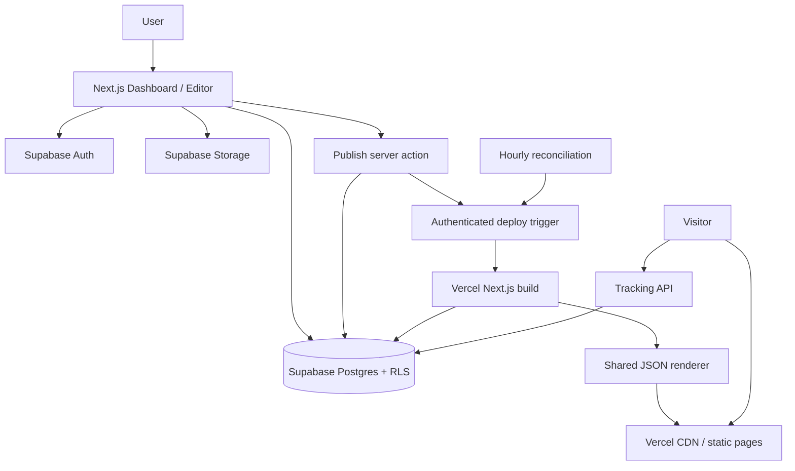

# LinkBio — Architecture

## 1. Purpose

Multi-tenant link-in-bio SaaS. A user selects a system template, creates a page instance, edits content/design tokens, previews, saves a draft and publishes to a unique URL: `/{username}/{pageSlug}`.

## 2. MVP decisions

- Next.js App Router, TypeScript, Tailwind CSS v4, shadcn/ui.
- Supabase Auth, Postgres, Storage, Row Level Security (RLS).
- Zod-validated JSON schema and shared component renderer for editor preview and public pages.
- Vercel for dashboard runtime, static prerendering and CDN.
- **On-demand publishing (decision 2026-11-25, replaces rebuild-per-publish).** `dynamicParams = false` is not available with `cacheComponents` in Next.js 16. Public pages are rendered on first visit from the live snapshot, through a `'use cache'` function tagged per page, and stored. Publish, rename and delete call `updateTag()` for the affected paths, so a publish is live in seconds without a Vercel rebuild.
- Publish freezes the reviewed draft revision as `live_version_id` in one transaction; the previous live version stays until then.
- No separate build worker or Astro/CloudFront.

## 3. System diagram

## 4. Runtime boundaries

- **Dashboard:** authenticated, dynamic Next.js routes and server actions.
- **Public pages:** build-time data fetch and static HTML; no database query required for rendering a page view. Tracking is a separate best-effort request.
- **Build:** server-only Supabase credentials, restricted to CI/deployment environment. Never bundle service-role credentials into browser code.
- **Shared renderer:** trusted, schema-validated configuration; no arbitrary HTML/JS/CSS execution.

## 5. Routing and tenancy

- `/{username}/{pageSlug}`; usernames globally unique, slugs unique per owner.
- `page_id` UUID is stable across username/slug changes.
- Reserve routes such as `/dashboard`, `/login`, `/api`, `/templates`, `/_next` to prevent collisions.
- Slug/username changes create redirect records; published redirects must be included in deployment routing.
- The template slug is a template identifier, **not** the page's global public identifier.

## 6. Editing and publishing

1. Login; select template.
2. Create owned page and deep-copy default config into a draft version.
3. Update draft using validated server-side writes; optimistic concurrency via revision/version.
4. Preview draft with same renderer as public page.
5. Publish (`publish_page(page_id, expected_revision)`) checks that the draft revision is the one the owner reviewed, then points `desired_version_id` and `live_version_id` at that immutable version. It is idempotent, and the page row lock serializes concurrent publishes.
6. The server action refreshes the page's cache tag (`updateTag`). The next visitor gets the new snapshot, rendered by the same `BioPage` as the preview.
7. Visitors read only through `get_published_page(username, slug)`, which returns the live config or a redirect for a renamed page and never a draft.

## 7. Rendering and styling

- `schemaVersion`, `templateId`, `theme`, `layout`, `blocks` (stable IDs, type, props, styles, visibility, responsive variants).
- Whitelist allowed block types and design-token values; use CSS variables for colors, radius, fonts, spacing.
- Fonts must be selected from an approved, licensed/hosted set; cap sizes, grid columns, URL schemes and media dimensions.
- Preview and public renderer share types/components; dashboard editor is client-side, public renderer defaults to server-side.
- Define schema migration functions when the format changes.

## 8. Security and performance

- RLS for all tenant-owned tables; server-side authorization for mutations and publish triggers.
- Supabase Storage policies separate private drafts and public published assets.
- Sanitize user-provided text and validate external URLs (`https:` only by default); reject `javascript:` and unsafe embeds.
- Rate-limit create/edit/publish and tracking endpoints; verify deploy hooks and callbacks.
- Tracking should avoid unnecessary personal data, support consent where required, and use retention/aggregation.
- Index owner and published route lookups; pagination for dashboard lists.

## 9. Deployment strategy and tradeoffs

Code deploys rebuild the app; publishing does not. Public pages are cached per path (`cacheLife('max')`) and refreshed by tag on publish, rename and delete. A database outage throws instead of caching a 404. Risk: a deploy starts with an empty cache, so the first visit to each page after a deploy reads Supabase. Unknown paths also cache their 404 per path; add rate limiting at the edge if this is abused.

## 10. Explicit non-goals (MVP)

Arbitrary user HTML/JS, custom domains, multi-region workers, advanced visual drag-and-drop canvas, full real-time ranking, complex n8n orchestration.

## 11. v2 direction (2026-11-26)

- Environments: our Supabase project `link-bio-tree` is Staging/Demo; production will be Eosoft's Supabase project (Supabase Auth + Google, the same as today).
- Our tables must not collide with Eosoft's `public` tables (`profiles`, `sites`, `site_members`, …). Approved: ours live in schema `linktree` (helpers in `linktree_private`); see `data-model.md` → "v2: Eosoft coexistence".
- Tenant = company, one company per user, roles `super_admin`/`owner`/`admin`/`editor`/`viewer` (proposed matrix in `data-model.md`).
- Writers: this app only, for now; external invalidation (V2-23) deferred.

## 12. Open decisions

- Public hostname and whether dashboard shares the same domain.
- Deployment trigger mechanism and deployment-ready verification provider.
- Tracking consent/privacy requirements and analytics retention.
- Template licensing and allowed font catalog.
