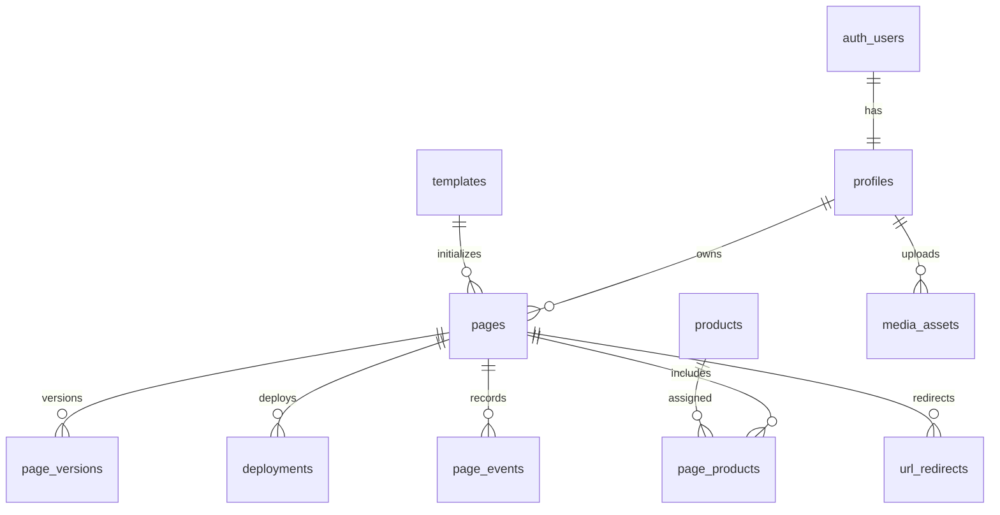

# LinkBio — Data Model (Supabase PostgreSQL)

## Conventions

UUID primary keys, `created_at`/`updated_at` timestamptz, snake_case, `auth.users` is the identity source. Use DB constraints in addition to application validation. Store page configs in versioned `jsonb` snapshots.

## Entity relationships

## Tables

### profiles

`id uuid PK references auth.users(id) on delete cascade`, `username citext unique not null`, `display_name text`, `created_at`, `updated_at`. Enforce username regex/length and reserved names in server logic + database check or reserved-name table.

### templates

`id uuid PK`, `key text unique not null` (`classic`, `video-first`, `shop-grid`), `name text`, `description text`, `manifest jsonb not null` (regions, allowed block types, `themeDefaults` — validated by `TemplateSchema`), `default_config jsonb not null` (a `PageConfigSchema` starter), `schema_version int`, `is_active boolean`, `created_at`. Read-only to ordinary users.

### Implementation notes (DB-01..06)

- Migrations: `supabase/migrations/2026112412*.sql`; tests: `supabase/tests/rls_test.sql`.
- `profiles.username` is null until claimed (ON-01), lowercase `^[a-z0-9][a-z0-9-]{2,29}$`, reserved route names blocked by a check constraint, and locked once set.
- `page_versions` are append-only (update blocked by trigger); every draft save inserts `revision + 1`. Composite FKs `(pages.id, *_version_id) → page_versions(page_id, id)` enforce that pointers stay within the page.
- Clients never insert/update `pages` or `page_versions` directly: `create_page(template_key, slug)` and `save_draft(page_id, expected_revision, config)` (security definer, `auth.uid()` checked, PostgREST `PT4xx` error codes: `SLUG_TAKEN`/`REVISION_CONFLICT` → 409, `USERNAME_REQUIRED` → 403). `status`, `desired_version_id`, `live_version_id`, deployments, redirects and events are server-only (service role).
- Storage bucket `media` is public-read; writes only under `<auth.uid()>/`.

### pages

`id uuid PK`, `owner_id uuid not null references profiles(id)`, `template_id uuid references templates(id)`, `slug text not null`, `status text check (status in ('draft','publishing','published','archived'))`, `draft_version_id uuid null`, `desired_version_id uuid null`, `live_version_id uuid null`, `created_at`, `updated_at`, `unique(owner_id,slug)`. Add version FKs after creating page_versions to avoid circular creation dependency. `status` alone does not prove a new version is live.

### page_versions

`id uuid PK`, `page_id uuid references pages(id) on delete cascade`, `revision bigint not null`, `schema_version int not null`, `config jsonb not null` (validated by `PageConfigSchema` in `src/lib/schemas/site.ts`; no slug/owner inside), `created_by uuid references profiles(id)`, `created_at`, `unique(page_id,revision)`. Treat published snapshots as immutable. Draft updates can create a new version per save or use a separate mutable draft with revision tracking.

### media_assets

`id uuid PK`, `owner_id uuid`, `storage_bucket text`, `storage_path text`, `mime_type text`, `bytes bigint`, `visibility text`, `created_at`. Enforce storage ownership in policies; never trust client-provided paths.

### products

`id uuid PK`, `owner_id uuid`, `title text`, `destination_url text`, `image_asset_id uuid`, `created_at`, `updated_at`. Only allow safe URL schemes.

### page_products

`page_id uuid`, `product_id uuid`, `position int`, `visible boolean`, primary key `(page_id,product_id)`; verify product owner matches page owner (server logic or trigger).

### deployments

`id uuid PK`, `page_id uuid nullable`, `requested_version_id uuid`, `provider_deployment_id text`, `status text check (status in ('queued','building','ready','failed','superseded'))`, `error_message text`, `created_at`, `completed_at`. A global build can affect multiple pages: for production, prefer a separate `release_deployments` + `release_pages` association rather than assuming one deployment per page.

### url_redirects

`id uuid PK`, `page_id uuid`, `old_path text unique`, `new_path text`, `created_at`. Prevent redirect loops and path collisions.

### page_events

`id bigint generated always as identity PK`, `page_id uuid`, `event_type text check (event_type in ('view','click'))`, `block_id text null`, `referrer_host text null`, `utm_source text null`, `occurred_at timestamptz default now()`. Use aggregate tables/materialized views for reporting at scale.

## Essential indexes

- `profiles(username)` unique (case-insensitive).
- `pages(owner_id, slug)` unique; `pages(owner_id, updated_at desc)`.
- `page_versions(page_id, revision desc)`.
- `page_events(page_id, occurred_at desc)` and optionally partition by month at scale.
- `deployments(status, created_at)`.

## RLS policy matrix

| Entity          | Anonymous                        | Authenticated owner       | Service/build role          |
| --------------- | -------------------------------- | ------------------------- | --------------------------- |
| profiles        | read public profile fields only  | update own                | controlled                  |
| templates       | read active                      | read active               | admin write                 |
| pages           | no draft reads                   | CRUD own                  | read published build inputs |
| page_versions   | no drafts                        | read/write own drafts     | read desired snapshots      |
| products/assets | only intentionally public assets | CRUD own                  | controlled                  |
| deployments     | none                             | read own status           | write verified status       |
| page_events     | no raw reads/writes              | aggregated analytics only | controlled ingestion        |

Use `auth.uid() = owner_id` (or joins to pages for child rows), `WITH CHECK` for inserts/updates, and test negative cross-tenant access. Anonymous public page data should be exposed through carefully scoped server/build queries, not open draft RLS policies.

## Migration sequence

1. Extensions (`citext`), profiles, templates, pages.
2. page_versions, add version pointers to pages.
3. products, page_products, media_assets.
4. deployments, url_redirects, events.
5. RLS/policies, triggers, indexes, seed templates, RLS tests.

## Data invariants

- `page_versions.page_id` must match the `pages.id` for each version pointer.
- A published version is immutable.
- Only owner may initiate publish; only trusted server may transition live deployment state.
- Deleting a page must account for public URLs, redirects and media cleanup.

- 2026-11-25: `rename_page(page_id, new_slug)` is a security definer function. It checks ownership, maps errors to PT400/403/404/409, and writes `url_redirects` only for pages that have a live version. A rename deletes any redirect from the new path and points older paths straight at the new one. Products stay in the page config (`catalog`). The `products` and `page_products` tables are unused for now.

- 2026-11-25: Publishing is on-demand. `publish_page(page_id, expected_revision)` is owner-only and returns `(revision, live_version_id, slug)`. It sets `desired_version_id` and `live_version_id` to the reviewed draft version and sets `status = 'published'`. `get_published_page(username, slug)` is the only public read path, granted to anon. It returns the live config, or `redirect_to` for an old path. Both functions are security definer because clients have no direct access to these tables. Both are covered by `supabase/tests/rls_test.sql`.
